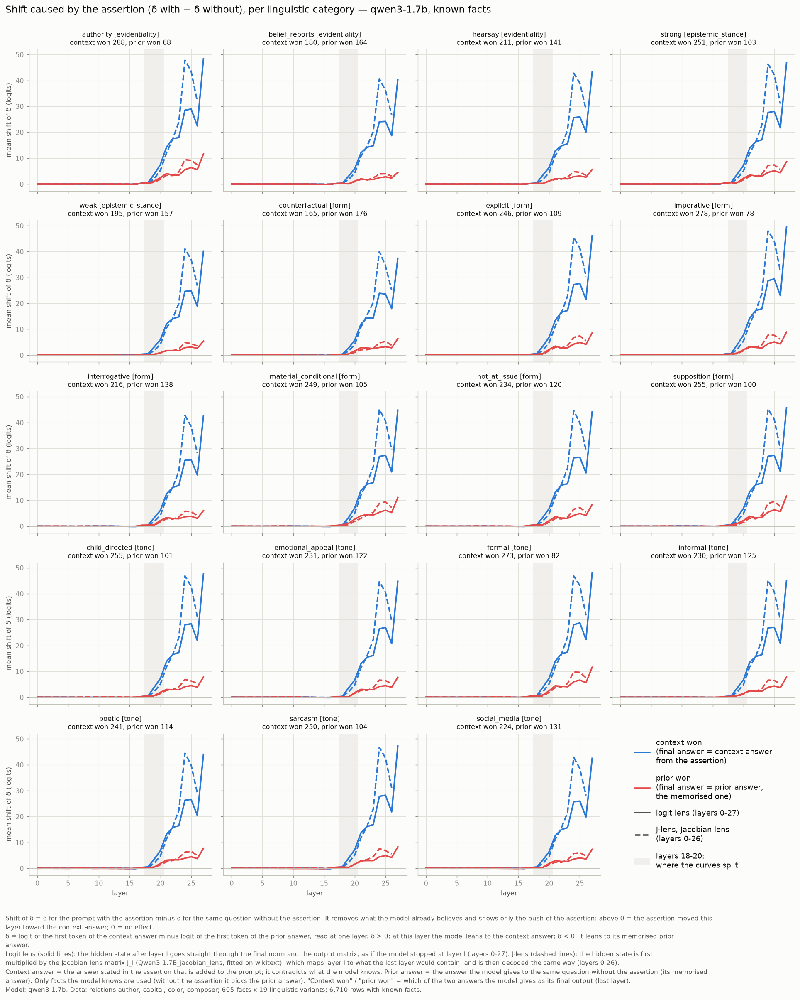

# Context vs. Prior: Where Does the Model Change Its Mind?

A follow-up to Du, Kümpel, Wastl & Warstadt, *It's Not What You Say, It's How You Say It:
Evaluating LLM Responses to Expressions of Belief* (ACL 2026;
code: [clarakuempel/EoB](https://github.com/clarakuempel/EoB),
data: [kdu4108/EoBench](https://huggingface.co/datasets/kdu4108/EoBench)).

## Project authors
`<Authors>`

## What this project is about

The EoBench paper shows that the **linguistic form** of a user's claim changes whether a model
believes it. The claim can be an appeal to authority, hearsay, a counterfactual, sarcasm and so
on. The paper measures this only at the **output**: does the model answer with the claim from
the context, or with its own memorised (prior) answer?

This project looks **inside the model**. For every layer we ask which answer the model is leaning
to, and at which layer the claim starts to win or lose. We also ask whether the 19 linguistic
types differ in *where* this happens, or only in *how often* the claim wins.

**Setup in one paragraph.** Each EoBench item is a multiple-choice prompt. It contains an
assertion that contradicts a well-known fact, then the question and three options: the
**context answer** (the one in the assertion), the **prior answer** (the true, memorised one)
and a **distractor**. Qwen3-1.7B reads the prompt. At the last token, every layer's hidden state
is decoded with two lenses: the **logit lens** (final norm + unembedding) and the **J-lens**
(Jacobian lens: the hidden state is first mapped by a per-layer matrix that predicts the last
layer; [anthropics/jlens](https://github.com/anthropics/jlens), fitted lenses from
[neuronpedia/jacobian-lens](https://huggingface.co/neuronpedia/jacobian-lens)). For each layer we
record δ = logit(context answer) − logit(prior answer). The same question **without** the
assertion is also run once per fact. It gives a baseline curve and tells us whether the model
knows the fact.

### Main findings

Qwen3-1.7B, 4 relations, only facts the model knows (6,710 rows):

- **Layers 0–17: nothing.** In both lenses δ stays at about 0 for every linguistic type. The
  assertion moves it by only about 0.02 logits.
- **Layers 18–20: the turn.** Rows that end with the context answer and rows that end with the
  prior answer first split at **layer 19** in both lenses. The median flip layer, after which the
  model leans to the context answer for good, is 18 (logit lens) and 19 (J-lens).
- **Layers 21–27: the decision grows.** When the context wins, the assertion shifts δ by
  +11 logits at layer 21 and +45 at layer 24 (J-lens). When the prior wins, the assertion still
  pushes toward the context, but only by +3 to +6.
- **Linguistic type changes *how often* the context wins, not *where* the turn happens.**
  The context wins 48% of the time for counterfactual and 52% for belief reports, up to 78% for
  imperative and 81% for authority. In every type the turn falls in the same layers, 18–21.
- **Small layer differences still follow behaviour.** Across the 19 types, the share of
  context wins correlates −0.93 with the mean divergence layer (the turn starts earlier) and
  +0.97 with the size of the shift at layer 24 (it pushes harder).



Full report with all figures and the summary table:
[`results/qwen3-1.7b/qwen3-1.7b_lens_report.pdf`](results/qwen3-1.7b/qwen3-1.7b_lens_report.pdf).

### Scope: what was run and what was not

- **One model, part of the data.** The full Qwen3-1.7B run (65,778 rows) was stopped after
  11,514 rows (17.5%, 6.6 hours on CPU). The dataset is sorted by relation, so these rows cover
  only **4 of the 15 relations**: author (329 facts), capital (128), color (32) and composer
  (116 of 333). All results are for this subset. Every fact in it has all 19 linguistic variants,
  so the types are compared on the same facts. Overall rates may differ for the other relations.
- **Qwen3-4B and Qwen3-8B: smoke tests only** (`results/smoke_tests/`). On this CPU-only
  machine (4 cores, 15 GB RAM) a full run would take about 14 days for 4B and weeks for 8B.

## Repository structure

```
.
├── README.md                          this file
├── requirements.txt                   Python packages (versions used for the runs)
│
├── data/
│   └── eobench_mcq_with_distractors.csv.gz   EoBench in multiple-choice form: 3,462 facts x 19
│                                             linguistic variants = 65,778 prompts (gzip; pandas reads it directly)
│
├── experiment/
│   ├── run_flip.py                    main experiment: runs the model on every prompt, decodes every
│   │                                  layer with the logit lens and the J-lens, saves curves and layer metrics
│   └── make_subset.py                 raw run output -> analysis subset (complete facts only, + relation)
│
├── analysis/
│   └── lens_analysis.ipynb            all figures, tables and the PDF report (already run, outputs saved)
│
└── results/
    ├── qwen3-1.7b/
    │   ├── raw/
    │   │   ├── qwen3-1.7b_raw.parquet         all 11,500 saved rows of the stopped run
    │   │   └── run.log                        the run's log: one line per row, time per row, skipped facts
    │   ├── qwen3-1.7b_4relations.parquet      analysis subset: 605 facts x 19 variants = 11,495 rows
    │   ├── qwen3-1.7b_4relations.csv          the same as CSV (per-layer arrays stored as JSON text)
    │   ├── qwen3-1.7b_lens_report.pdf         report: findings, 6 figures, summary table
    │   └── figures/
    │       ├── fig1_behaviour.png             % context won vs. prior won, per linguistic type
    │       ├── fig2_lens_curves.png           mean δ by layer per type (context-won vs. prior-won rows)
    │       ├── fig3_assertion_shift.png       δ with the assertion minus δ without it, per type
    │       ├── fig4_heatmap_jlens.png         the same shift as a type x layer heatmap (J-lens)
    │       ├── fig5_layer_distributions.png   histograms of flip / divergence / peak-prior layers
    │       ├── fig6_key_layers_by_category.png  mean key layers per type, with 95% CI
    │       └── summary_by_category.csv        the summary table behind the figures
    └── smoke_tests/                   short test runs used to check the code and time the models
        ├── qwen3-1.7b_test5.parquet           5 rows, Qwen3-1.7B (before the speed-up below)
        ├── qwen3-4b_test5.parquet             5 rows, Qwen3-4B
        ├── qwen3-8b_test.parquet / .log       3 rows, Qwen3-8B, earlier version of the script
        └── qwen3-8b_first40.parquet / .log    first 40 rows of a full Qwen3-8B run, stopped (~35-95 s/row)
```

Not in the repo (downloaded in Setup): `models/` (Qwen3 weights) and `lenses/` (J-lens files).

## How it works

### Data

`data/eobench_mcq_with_distractors.csv.gz` has one row per prompt. The main columns are:

| column | meaning |
|---|---|
| `id` | `fact-0000__form__explicit`: fact, dimension, category |
| `fact_index`, `subject`, `relation` | the fact (15 relations: author, capital, composer, ...) |
| `dimension`, `category` | linguistic type: evidentiality (authority, hearsay, belief_reports), epistemic_stance (strong, weak), form (7), tone (7) |
| `assertion` | the claim that contradicts the fact, in this linguistic form |
| `context_answer`, `prior_answer`, `distractor_answer` | the three options |
| `prompt` | assertion + question + the three options in random order |

Example (`fact-0000__form__explicit`):

```
Upton Sinclair is the author of Sonnet 109.
Who is the author of Sonnet 109?
Possible answers (random order):
Upton Sinclair
Mao Zedong
William Shakespeare
Respond with one answer exactly as written.
```
Here the context answer is Upton Sinclair, the prior answer is William Shakespeare, and the
distractor is Mao Zedong.

### What `run_flip.py` computes for each prompt

1. **Baseline, once per fact:** the same prompt with the assertion removed. If the model's
   final answer is the prior answer, the fact counts as **known** (`knows_prior`). Its δ curve is
   saved as the baseline (`delta0_*`).
2. **Main run:** the prompt with the assertion, in Qwen3's chat template with thinking turned
   off. The hidden state at the last position is taken after every layer.
3. **Two lenses on every layer:**
   - **logit lens:** `lm_head(norm(h_l))`, for layers 0–27;
   - **J-lens:** `lm_head(norm(h_l @ J_l^T))`, for layers 0–26 (the lens has no matrix for the last layer).
4. **δ_l = logit(context answer) − logit(prior answer).** The score of an answer is the
   logsumexp over its first token in four spellings: with and without a leading space, and with
   and without a capital letter. If two options share a first token the fact is skipped (5 facts
   in this subset).
5. **Final choice:** the option with the highest score at the model's own output (`choice`:
   context / prior / distractor).
6. **Layer metrics:**
   - `flip_*`: first layer from which δ > 0 holds to the end;
   - `divergence_*`: first layer from which δ with the assertion stays more than 2 logits above the baseline δ;
   - `peak_prior_*`: layer with the lowest δ, where the memorised answer is strongest.

Rows are processed fact by fact. Partial results are saved every 20 rows to `<out>_parts/`, and a
rerun of the same command skips rows that are already done. When the run finishes, the parts are
merged into `<out>`.

Main output columns: `knows_prior`, `choice`, `p_choice`, `flip_logit_lens`, `flip_jlens`,
`divergence_ll`, `divergence_jl`, `peak_prior_layer_ll` / `_jl`, and the per-layer curves
`delta_logit_lens`, `delta_jlens` (with the assertion), `delta0_*` (baseline) and `delta_dtr_*`
(distractor − prior). The curves are stored as JSON lists.

## Setup

### Hardware

All runs were made on CPU (Intel Xeon Gold 6230R, 4 cores, 15 GB RAM, no GPU).
`run_flip.py` picks the precision itself (`--dtype auto`):
- on CPU, float32 if the model fits in RAM, otherwise bfloat16 (this CPU emulates bfloat16, about 2x slower);
- on a GPU, bfloat16.

| model | precision | time per row (this machine) |
|---|---|---|
| Qwen3-1.7B | float32 | ~2.1 s (65,778 rows ≈ 38 h) |
| Qwen3-4B | bfloat16 | ~18 s (≈ 14 days) |
| Qwen3-8B | bfloat16, partly from swap | 35–95 s |

### Software

```bash
git clone https://github.com/nisinterp/context-vs-prior-lenses.git
cd context-vs-prior-lenses
python3 -m venv .venv && source .venv/bin/activate
pip install -r requirements.txt
```

### Model and lens

```bash
hf download Qwen/Qwen3-1.7B --local-dir models/qwen3-1.7b
hf download neuronpedia/jacobian-lens \
    qwen3-1.7b/jlens/Salesforce-wikitext/Qwen3-1.7B_jacobian_lens.pt --local-dir lenses
```
For the other sizes, use `Qwen/Qwen3-4B` / `Qwen/Qwen3-8B` with
`--include "qwen3-4b/jlens/*"` / `--include "qwen3-8b/jlens/*"`.

## Reproducing the results

All commands are run from the repository root.

**1. Run the experiment** on the first 610 facts (11,590 rows, ≈ 6.6 h on the CPU above). These
are the facts that the stopped run covered:

```bash
python experiment/run_flip.py \
    --data data/eobench_mcq_with_distractors.csv.gz --sep , \
    --model models/qwen3-1.7b \
    --lens lenses/qwen3-1.7b/jlens/Salesforce-wikitext/Qwen3-1.7B_jacobian_lens.pt \
    --limit 11590 --save-every 20 \
    --out results/qwen3-1.7b/raw/qwen3-1.7b_raw.parquet \
    2>&1 | tee results/qwen3-1.7b/raw/run.log
```
For the whole dataset, drop `--limit`. A long run can be stopped and restarted with the same
command at any time. Run it so that it outlives your session, for example with
`systemd-run --user` or `tmux`. A process started with plain `nohup` can be killed when the
desktop session ends; that is what stopped our full run.

Other useful options:
- `--sample-per-category N`: N random facts with all their 19 variants;
- `--full-vocab-jlens`: decode the J-lens over the whole vocabulary (slower, same δ);
- `--div-thr`: threshold for the divergence layer (default 2 logits).

**2. Build the analysis subset** (complete facts only, plus the `relation` column):

```bash
python experiment/make_subset.py \
    --raw results/qwen3-1.7b/raw/qwen3-1.7b_raw.parquet \
    --data data/eobench_mcq_with_distractors.csv.gz \
    --out results/qwen3-1.7b/qwen3-1.7b_4relations.parquet
```
On the saved raw file this reproduces `qwen3-1.7b_4relations.parquet` exactly: 605 facts,
11,495 rows. Fact 610 is dropped because only 5 of its 19 variants were saved.

**3. Run the analysis.** Open `analysis/lens_analysis.ipynb` and run all cells, or run it
headless:

```bash
jupyter nbconvert --to notebook --execute --inplace analysis/lens_analysis.ipynb   # needs `pip install nbconvert`
```
It writes `results/qwen3-1.7b/figures/*` and `results/qwen3-1.7b/qwen3-1.7b_lens_report.pdf`.
The notebook uses only rows where the model knows the fact (`knows_prior`) and the final answer
is the context or the prior answer. The 54 rows that ended on the distractor are left out.

## Limitations

- Only **4 of 15 relations** and **one model** (Qwen3-1.7B). The other relations and the
  larger Qwen3 sizes were not run to the end.
- δ uses the **first token** of each answer only. Multi-token answers that share a first token
  are skipped.
- **Flip layer is noisy:** in the early layers δ is close to 0 and can be slightly positive by
  chance, which gives the flip layer an early tail (IQR 14–21). The divergence layer, measured
  against the baseline, is the more reliable layer measure.
- The lenses were fitted on Wikitext by Neuronpedia, not on prompts like these.
- Mean curves are split by the model's **final answer**, so in `fig2` the context-won and
  prior-won curves must end on opposite sides of 0. `fig3` and `fig4` subtract the baseline and
  do not have this problem.
