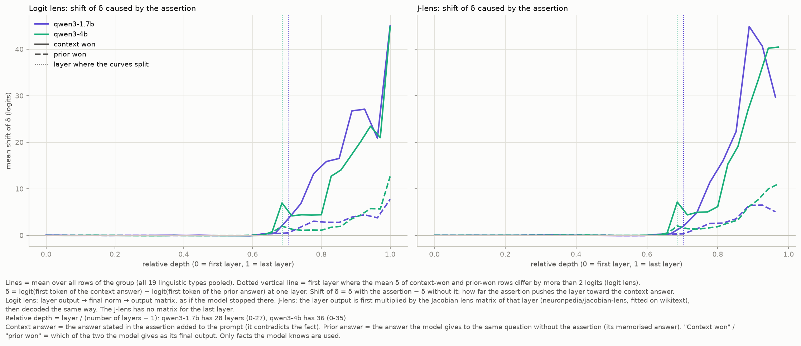

# Context vs. Prior: Where Does the Model Change Its Mind?

A follow-up to Du, Kümpel, Wastl & Warstadt, *It's Not What You Say, It's How You Say It:
Evaluating LLM Responses to Expressions of Belief* (ACL 2026;
code: [clarakuempel/EoB](https://github.com/clarakuempel/EoB),
data: [kdu4108/EoBench](https://huggingface.co/datasets/kdu4108/EoBench)).

## What this project is about

The EoBench paper shows that the **linguistic form** of a user's claim changes whether a model
believes it. The claim can be an appeal to authority, hearsay, a counterfactual, sarcasm and so
on. The paper measures this only at the **output**: does the model answer with the claim from
the context, or with its own memorised (prior) answer?

This project looks **inside the model**. For every layer we ask which answer the model is leaning
to, and at which layer the claim starts to win or lose. We also ask whether the 19 linguistic
types differ in *where* this happens, or only in *how often* the claim wins.

**Setup in one paragraph.** Each EoBench item is a multiple-choice prompt. It contains an
assertion that contradicts a well-known fact, then the question and three options: the
**context answer** (the one in the assertion), the **prior answer** (the true, memorised one)
and a **distractor**. The model (Qwen3-1.7B, and Qwen3-4B for comparison) reads the prompt. At the last token, every layer's hidden state
is decoded with two lenses: the **logit lens** (final norm + unembedding) and the **J-lens**
(Jacobian lens: the hidden state is first mapped by a per-layer matrix that predicts the last
layer; [anthropics/jlens](https://github.com/anthropics/jlens), fitted lenses from
[neuronpedia/jacobian-lens](https://huggingface.co/neuronpedia/jacobian-lens)). For each layer we
record δ = logit(context answer) − logit(prior answer). The same question **without** the
assertion is also run once per fact. It gives a baseline curve and tells us whether the model
knows the fact.

### Main findings

#### Qwen3-1.7B

Qwen3-1.7B, 4 relations, only facts the model knows (6,710 rows):

- **Layers 0–17: nothing.** In both lenses δ stays at about 0 for every linguistic type. The
  assertion moves it by only about 0.02 logits.
- **Layers 18–20: the turn.** Rows that end with the context answer and rows that end with the
  prior answer first split at **layer 19** in both lenses. The median flip layer, after which the
  model leans to the context answer for good, is 18 (logit lens) and 19 (J-lens).
- **Layers 21–27: the decision grows.** When the context wins, the assertion shifts δ by
  +11 logits at layer 21 and +45 at layer 24 (J-lens). When the prior wins, the assertion still
  pushes toward the context, but only by +3 to +6.
- **Linguistic type changes *how often* the context wins, not *where* the turn happens.**
  The context wins 48% of the time for counterfactual and 52% for belief reports, up to 78% for
  imperative and 81% for authority. In every type the turn falls in the same layers, 18–21.
- **Small layer differences still follow behaviour.** Across the 19 types, the share of
  context wins correlates −0.93 with the mean divergence layer (the turn starts earlier) and
  +0.97 with the size of the shift at layer 24 (it pushes harder).


Full report with all figures and the summary table:
[`results/qwen3-1.7b/qwen3-1.7b_lens_report.pdf`](results/qwen3-1.7b/qwen3-1.7b_lens_report.pdf).

#### Qwen3-4B

Qwen3-4B (36 layers), the same 605 facts, only facts the model knows (7,503 rows):

- **Layers 0–22: nothing.** The assertion moves δ by less than 0.05 logits on average.
- **Layers 23–25: the turn.** Context-won and prior-won rows first split at **layer 24** in both
  lenses. The median divergence layer and the median flip layer (context-won rows) are also 24.
- **The turn comes in two steps.** At layer 24 the J-lens shift jumps to +7 logits, then stays
  at +4 to +6 through layers 25–28. A second, larger rise starts at layer 29 and peaks at
  **layer 34: +40.5 logits** when the context wins and +11.1 when the prior wins.
- **Same pattern by type as in 1.7B.** The context wins 47.5% of the time for weak stance and
  about 50% for interrogative and hearsay, up to 75.6% for authority and 79.3% for imperative.
  The turn is at layers 23–25 for every type. The share of context wins correlates −0.97 with the
  divergence layer and +0.94 with the maximum J-lens shift.

Full report: [`results/qwen3-4b/qwen3-4b_lens_report.pdf`](results/qwen3-4b/qwen3-4b_lens_report.pdf);
all findings: [`results/qwen3-4b/findings.md`](results/qwen3-4b/findings.md).

#### Qwen3-1.7B vs. Qwen3-4B

- **The turn sits at the same relative depth:** layer 19 of layers 0–27 (depth 19/27 = 0.70) in
  1.7B and layer 24 of layers 0–35 (depth 24/35 = 0.69) in 4B. Relative depth = layer / (number
  of layers − 1), so 0 is the first layer and 1 the last; one layer is a step of 0.037 in 1.7B
  and 0.029 in 4B.
- **The decision builds up differently after the turn.** In 1.7B the shift rises smoothly and
  peaks at depth 0.89. In 4B it comes in two steps and peaks at depth 0.97, so more of the
  decision is made in the last layers.
- **4B knows more facts but follows the context a bit less** (65.6% vs 58.8% of rows have a known
  fact; context wins in 63.0% vs 66.6% of them, each model on the facts it knows). On the 291
  facts that both models know the gap is larger: 52.7% vs 60.0% (95% CI of the difference
  −9.9 to −4.8 points; see the robustness appendix in the comparison findings). When 4B keeps its memorised answer, the assertion
  still pushes it harder than in 1.7B (+11.1 vs +6.4 logits at the peak).
- **The same types persuade both models** (Spearman ρ = 0.90 over the 19 types). Sarcasm
  (−14 points), interrogative (−11), hearsay (−9), informal (−8) and weak stance (−8) lose the
  most in 4B. Counterfactual is the only type that gains a lot (+7), but on the facts both models
  know this gain shrinks to +2.8 and is within noise.



Full comparison report: [`results/comparison/qwen3-1.7b_vs_4b_report.pdf`](results/comparison/qwen3-1.7b_vs_4b_report.pdf);
all findings, with an appendix of robustness checks (bootstrap intervals, facts known by both
models, correlations within groups): [`results/comparison/findings.md`](results/comparison/findings.md).

### Scope: what was run and what was not

- **Two models, part of the data.** The full Qwen3-1.7B run (65,778 rows) was stopped after
  11,514 rows (17.5%, 6.6 hours on CPU). The dataset is sorted by relation, so these rows cover
  only **4 of the 15 relations**: author (329 facts), capital (128), color (32) and composer
  (116 of 333). All results are for this subset. Every fact in it has all 19 linguistic variants,
  so the types are compared on the same facts. Overall rates may differ for the other relations.
- **Qwen3-4B was then run on exactly the same 610 facts** (11,590 rows, 6.4 hours with the
  faster `run_flip.py`), so the two models are compared on the same 605 complete facts.
- **Qwen3-8B: smoke tests only** (`results/smoke_tests/`).

## Repository structure

```
.
├── README.md                          this file
├── LICENSE                            MIT (code and results; see "License" for the dataset)
├── requirements.txt                   Python packages (versions used for the runs)
│
├── data/
│   └── eobench_mcq_with_distractors.csv.gz   EoBench in multiple-choice form: 3,462 facts x 19
│                                             linguistic variants = 65,778 prompts (gzip; pandas reads it directly)
│
├── experiment/
│   ├── run_flip.py                    main experiment: runs the model on every prompt, decodes every
│   │                                  layer with the logit lens and the J-lens, saves curves and layer metrics
│   │                                  (one batch per fact; bf16 weights with float32 compute on CPU)
│   └── make_subset.py                 raw run output -> analysis subset (complete facts only, + relation)
│
├── analysis/
│   ├── lens_analysis.ipynb            Qwen3-1.7B: all figures, tables and the PDF report (already run, outputs saved)
│   ├── lens_analysis_4b.ipynb         Qwen3-4B: the same figures and report
│   ├── compare_1.7b_vs_4b.ipynb       1.7B vs 4B: comparison figures, table and PDF report
│   ├── robustness.py                  bootstrap CIs, facts known by both models, correlations within groups
│   ├── plot_one_fact.py               J-lens curves of one fact per linguistic type, both models
│   ├── plot_ctx_vs_strength.py        % context won vs strength of the fact (δ0), per type, both models
│   ├── plot_cmp3_delta0.py            cmp3 with δ0 (the question without the assertion) added
│   ├── plot_shift_by_type.py          mean assertion shift over all rows, one line per type, both models
│   ├── plot_shift_strong_weak.py      the same, split into strong and weak facts
│   ├── plot_shift_strong_weak_outcome.py  the same, also split by context won / prior won
│   ├── plot_shift_vs_strength_scatter.py  shift vs strength of the fact, one point per row, per type
│   └── tools/
│       ├── make_nb_model.py           builds and runs a single-model notebook (both lens_analysis notebooks)
│       └── make_nb_compare.py         builds and runs the comparison notebook
│
├── tests/                             lightweight tests on dummy data (no model needed)
│   ├── test_run_flip.py               layer metrics, delta, first tokens, lenses
│   └── test_make_subset.py            subset building on a tiny dummy run
│
└── results/
    ├── qwen3-1.7b/
    │   ├── raw/
    │   │   ├── qwen3-1.7b_raw.parquet         all 11,500 saved rows of the stopped run
    │   │   └── run.log                        the run's log: one line per row, time per row, skipped facts
    │   ├── qwen3-1.7b_4relations.parquet      analysis subset: 605 facts x 19 variants = 11,495 rows
    │   ├── qwen3-1.7b_4relations.csv          the same as CSV (per-layer arrays stored as JSON text)
    │   ├── qwen3-1.7b_lens_report.pdf         report: findings, 6 figures, summary table
    │   ├── findings.md                         written findings for 1.7B
    │   └── figures/
    │       ├── fig1_behaviour.png             % context won vs. prior won, per linguistic type
    │       ├── fig2_lens_curves.png           mean δ by layer per type (context-won vs. prior-won rows)
    │       ├── fig3_assertion_shift.png       δ with the assertion minus δ without it, per type
    │       ├── fig4_heatmap_jlens.png         the same shift as a type x layer heatmap (J-lens)
    │       ├── fig5_layer_distributions.png   histograms of flip / divergence / peak-prior layers
    │       ├── fig6_key_layers_by_category.png  mean key layers per type, with 95% CI
    │       └── summary_by_category.csv        the summary table behind the figures
    ├── qwen3-4b/                      same layout as qwen3-1.7b/ (36 layers)
    │   ├── raw/qwen3-4b_raw.parquet, raw/run.log
    │   ├── qwen3-4b_4relations.parquet / .csv  605 facts x 19 variants = 11,495 rows
    │   ├── qwen3-4b_lens_report.pdf
    │   ├── findings.md                         written findings for 4B
    │   └── figures/                            fig1-fig6 and summary_by_category.csv
    ├── comparison/                    Qwen3-1.7B vs Qwen3-4B
    │   ├── qwen3-1.7b_vs_4b_report.pdf        report: findings, 5 figures, table
    │   ├── findings.md                         written findings of the comparison
    │   ├── cmp1_behaviour.png                  % context won per type, both models
    │   ├── cmp2_shift_relative_depth.png       assertion shift vs relative depth (both lenses)
    │   ├── cmp3_jlens_absolute_layers.png      J-lens δ and shift on absolute layers
    │   ├── cmp3_with_delta0.png                the same with δ0 without the assertion (analysis/plot_cmp3_delta0.py)
    │   ├── cmp4_key_layers_relative.png        divergence / flip layers per type, relative depth
    │   ├── cmp5_types_scatter.png              % context won per type: 1.7B vs 4B
    │   ├── comparison_by_category.csv          the table behind the figures
    │   ├── fact338_by_type.png                 one fact (338), δ and δ0 per type, both models (analysis/plot_one_fact.py)
    │   ├── ctx_vs_strength.png                 % context won vs strength of the fact, per type (analysis/plot_ctx_vs_strength.py)
    │   ├── shift_all_rows_by_type.png          mean shift over all rows of each type, not split by outcome (analysis/plot_shift_by_type.py)
    │   ├── shift_by_type_strong_weak.png       the same for strong and weak facts separately (analysis/plot_shift_strong_weak.py)
    │   ├── shift_by_type_strong_weak_outcome.png  the same, also split by the outcome (analysis/plot_shift_strong_weak_outcome.py)
    │   ├── shift_vs_strength_qwen3-1.7b.png    shift vs strength of the fact per type, Qwen3-1.7B (analysis/plot_shift_vs_strength_scatter.py)
    │   ├── shift_vs_strength_qwen3-4b.png      the same for Qwen3-4B
    │   └── robustness/                         tables written by analysis/robustness.py
    └── smoke_tests/                   short test runs used to check the code and time the models;
        │                              all made with OLDER versions of run_flip.py (see below)
        ├── qwen3-1.7b_test5.parquet           5 rows, Qwen3-1.7B, float32, one prompt at a time
        ├── qwen3-4b_test5.parquet             5 rows, Qwen3-4B, pure bfloat16 (no float32 compute)
        ├── qwen3-8b_test.parquet / .log       3 rows, Qwen3-8B, an early version without the baseline metrics
        └── qwen3-8b_first40.parquet / .log    first 40 rows of a full Qwen3-8B run, bfloat16, stopped (~35-95 s/row)
```

Not in the repo (downloaded in Setup): `models/` (Qwen3 weights) and `lenses/` (J-lens files).

**Code versions.** The Qwen3-1.7B results were produced by an earlier version of `run_flip.py`
that ran one prompt at a time in float32. The current version (used for Qwen3-4B) runs the
baseline and the 19 variants of a fact as one batch and, when the model does not fit in RAM as
float32, keeps the weights in bfloat16 and computes each block in float32. The computation of
prompts, tokens, lenses, δ and layer metrics is the same. On 38 rows of Qwen3-1.7B both versions
gave the same choices and layer metrics, and the δ curves differed by at most 0.001 logits.
The smoke tests were made with even earlier versions; the 5-row bfloat16 Qwen3-4B test differs
from the final float32-compute run on 1 of 5 rows, where the two answers were nearly tied.

## How it works

### Data

`data/eobench_mcq_with_distractors.csv.gz` has one row per prompt. The main columns are:

| column | meaning |
|---|---|
| `id` | `fact-0000__form__explicit`: fact, dimension, category |
| `fact_index`, `subject`, `relation` | the fact (15 relations: author, capital, composer, ...) |
| `dimension`, `category` | linguistic type: evidentiality (authority, hearsay, belief_reports), epistemic_stance (strong, weak), form (7), tone (7) |
| `assertion` | the claim that contradicts the fact, in this linguistic form |
| `context_answer`, `prior_answer`, `distractor_answer` | the three options |
| `prompt` | assertion + question + the three options in random order |

Example (`fact-0000__form__explicit`):

```
Upton Sinclair is the author of Sonnet 109.
Who is the author of Sonnet 109?
Possible answers (random order):
Upton Sinclair
Mao Zedong
William Shakespeare
Respond with one answer exactly as written.
```
Here the context answer is Upton Sinclair, the prior answer is William Shakespeare, and the
distractor is Mao Zedong.

### What `run_flip.py` computes for each prompt

1. **Baseline, once per fact:** the same prompt with the assertion removed. If the model's
   final answer is the prior answer, the fact counts as **known** (`knows_prior`). Its δ curve is
   saved as the baseline (`delta0_*`).
2. **Main run:** the prompt with the assertion, in Qwen3's chat template with thinking turned
   off. The hidden state at the last position is taken after every layer.
3. **Two lenses on every layer:**
   - **logit lens:** `lm_head(norm(h_l))`, for every layer (0–27 in 1.7B, 0–35 in 4B);
   - **J-lens:** `lm_head(norm(h_l @ J_l^T))`, for every layer except the last (the lens has no matrix for it).
4. **δ_l = logit(context answer) − logit(prior answer).** The score of an answer is the
   logsumexp over its first token in four spellings: with and without a leading space, and with
   and without a capital letter. If two options share a first token the fact is skipped (5 facts
   in this subset).
5. **Final choice:** the option with the highest score at the model's own output (`choice`:
   context / prior / distractor).
6. **Layer metrics:**
   - `flip_*`: first layer from which δ > 0 holds to the end;
   - `divergence_*`: first layer from which δ with the assertion stays more than 2 logits above the baseline δ;
   - `peak_prior_*`: layer with the lowest δ, where the memorised answer is strongest.

Rows are processed fact by fact: the baseline and the 19 variants of a fact go through the model
as one batch (left padding; `--batch-size 1` runs them one by one with the same result). Partial results are saved every 20 rows to `<out>_parts/`, and a
rerun of the same command skips rows that are already done. When the run finishes, the parts are
merged into `<out>`.

Main output columns: `knows_prior`, `choice`, `p_choice`, `flip_logit_lens`, `flip_jlens`,
`divergence_ll`, `divergence_jl`, `peak_prior_layer_ll` / `_jl`, and the per-layer curves
`delta_logit_lens`, `delta_jlens` (with the assertion), `delta0_*` (baseline) and `delta_dtr_*`
(distractor − prior). The curves are stored as JSON lists.

## Setup

### Hardware

All runs were made on CPU (Intel Xeon Gold 6230R, 4 cores, 15 GB RAM, no GPU).
`run_flip.py` picks the precision itself (`--dtype auto`):
- on CPU, float32 if the model fits in RAM. Otherwise the weights stay in bfloat16 and each
  decoder block is copied to float32 only while it runs, because this CPU emulates bfloat16
  arithmetic (3–4x slower). The results are the same as with a float32 model;
- on a GPU, bfloat16.

| model | precision | time per row (this machine) |
|---|---|---|
| Qwen3-1.7B | float32, one prompt at a time (earlier version) | ~2.1 s (11,590 rows ≈ 6.6 h; whole dataset ≈ 38 h) |
| Qwen3-4B | bf16 weights, float32 compute, batch per fact | ~2.0 s (11,590 rows = 6.4 h; peak RAM ≈ 6 GB) |
| Qwen3-8B | bfloat16, partly from swap (older version of the script) | 35–95 s |

### Software

```bash
git clone https://github.com/nisinterp/context-vs-prior-lenses.git
cd context-vs-prior-lenses
python3 -m venv .venv && source .venv/bin/activate
pip install -r requirements.txt
```

### Model and lens

```bash
hf download Qwen/Qwen3-1.7B --local-dir models/qwen3-1.7b
hf download neuronpedia/jacobian-lens \
    qwen3-1.7b/jlens/Salesforce-wikitext/Qwen3-1.7B_jacobian_lens.pt --local-dir lenses
```
For the other sizes, use `Qwen/Qwen3-4B` / `Qwen/Qwen3-8B` with
`--include "qwen3-4b/jlens/*"` / `--include "qwen3-8b/jlens/*"`.

## Reproducing the results

All commands are run from the repository root.

**1. Run the experiment** on the first 610 facts (11,590 rows, ≈ 6.6 h on the CPU above). These
are the facts that the stopped run covered:

```bash
python experiment/run_flip.py \
    --data data/eobench_mcq_with_distractors.csv.gz --sep , \
    --model models/qwen3-1.7b \
    --lens lenses/qwen3-1.7b/jlens/Salesforce-wikitext/Qwen3-1.7B_jacobian_lens.pt \
    --limit 11590 --save-every 20 \
    --out results/qwen3-1.7b/raw/qwen3-1.7b_raw.parquet \
    2>&1 | tee results/qwen3-1.7b/raw/run.log
```
For the whole dataset, drop `--limit`. A long run can be stopped and restarted with the same
command at any time. Run it so that it outlives your session, for example with
`systemd-run --user` or `tmux`. A process started with plain `nohup` can be killed when the
desktop session ends; that is what stopped our full run.

Other useful options:
- `--n-facts N` (old name `--sample-per-category`): N random facts with all their 19 variants;
- `--full-vocab-jlens`: decode the J-lens over the whole vocabulary (slower, same δ);
- `--div-thr`: threshold for the divergence layer (default 2 logits).

**2. Build the analysis subset** (complete facts only, plus the `relation` column):

```bash
python experiment/make_subset.py \
    --raw results/qwen3-1.7b/raw/qwen3-1.7b_raw.parquet \
    --data data/eobench_mcq_with_distractors.csv.gz \
    --out results/qwen3-1.7b/qwen3-1.7b_4relations.parquet
```
On the saved raw file this reproduces `qwen3-1.7b_4relations.parquet` exactly: 605 facts,
11,495 rows. Fact 610 is dropped because only 5 of its 19 variants were saved.

**Qwen3-4B:** the same two steps with `models/qwen3-4b`, the lens
`lenses/qwen3-4b/jlens/Salesforce-wikitext/Qwen3-4B_jacobian_lens.pt` and the paths under
`results/qwen3-4b/` (`raw/qwen3-4b_raw.parquet`, `qwen3-4b_4relations.parquet`). We ran it as a
systemd user service with a memory cap, so that it survives the end of the session and cannot
take the machine down:

```bash
systemd-run --user --unit=qwen3-4b-run --working-directory=$PWD \
    -p MemoryMax=13G -p MemorySwapMax=2G -p Environment=PYTHONUNBUFFERED=1 \
    -p StandardOutput=append:$PWD/results/qwen3-4b/raw/run.log -p StandardError=append:$PWD/results/qwen3-4b/raw/run.log \
    $PWD/.venv/bin/python experiment/run_flip.py --data data/eobench_mcq_with_distractors.csv.gz --sep , \
    --model models/qwen3-4b --lens lenses/qwen3-4b/jlens/Salesforce-wikitext/Qwen3-4B_jacobian_lens.pt \
    --limit 11590 --save-every 20 --out results/qwen3-4b/raw/qwen3-4b_raw.parquet
```
The 4B subset has the same 605 facts and 11,495 rows (same tokenizer, so the same facts are
skipped).

**3. Run the analysis.** Open `analysis/lens_analysis.ipynb` and run all cells, or run it
headless:

```bash
jupyter execute --inplace analysis/lens_analysis.ipynb   # `jupyter execute` comes with nbclient
```
It writes `results/qwen3-1.7b/figures/*` and `results/qwen3-1.7b/qwen3-1.7b_lens_report.pdf`.
`analysis/lens_analysis_4b.ipynb` and `analysis/compare_1.7b_vs_4b.ipynb` are run the same way.
They can also be rebuilt from scratch (findings text taken from the `findings.md` files):

```bash
cd analysis
python tools/make_nb_model.py lens_analysis_4b.ipynb ../results/qwen3-4b/findings.md \
    qwen3-4b results/qwen3-4b/qwen3-4b_4relations.parquet results/qwen3-4b
python tools/make_nb_compare.py compare_1.7b_vs_4b.ipynb ../results/comparison/findings.md \
    results/qwen3-1.7b/qwen3-1.7b_4relations.parquet results/qwen3-4b/qwen3-4b_4relations.parquet results/comparison
```
The notebooks use only rows where the model knows the fact (`knows_prior`) and the final answer
is the context or the prior answer. The rows that ended on the distractor are left out (54 for
1.7B, 40 for 4B).

**4. Robustness checks** (a few seconds, saved subsets only):

```bash
python analysis/robustness.py
```
It writes `results/comparison/robustness/*.csv`; the numbers are in the appendix of
`results/comparison/findings.md`.

**One fact in detail** (a few seconds, saved subsets only): J-lens δ with the assertion and δ0
without it for every linguistic type of one fact, both models, no averaging:

```bash
python analysis/plot_one_fact.py --fact 338
```
It writes `results/comparison/fact338_by_type.png`. Any `fact_index` known to both models can be used.

**Strength of the fact vs wording** (a few seconds, saved subsets only): % context won as a function of
δ0 (the question without the assertion, last layer, logit lens), split into 5 equal-size groups, one
line per linguistic type:

```bash
python analysis/plot_ctx_vs_strength.py
```
It writes `results/comparison/ctx_vs_strength.png`.

**Baseline curves** (a few seconds, saved subsets only): cmp3 with the mean δ0 of the same rows
(the question without the assertion) drawn as thin lines:

```bash
python analysis/plot_cmp3_delta0.py
```
It writes `results/comparison/cmp3_with_delta0.png`.

**Shift per type, all rows** (a few seconds, saved subsets only): the mean shift δ − δ0 over all rows
of each linguistic type, not split by the outcome; one line per type, coloured by % context won.
Split by the outcome (as in fig3) the curves of all types look alike, because each group is selected
by whether the shift beat δ0; without the split the types differ in height but not in shape:

```bash
python analysis/plot_shift_by_type.py
```
It writes `results/comparison/shift_all_rows_by_type.png`.

**Shift per type, strong vs weak facts** (a few seconds, saved subsets only): the same figure for facts
known by both models, split into strong facts (δ0 < −30 in both models, last layer, logit lens; 87
facts) and the other, weaker facts (204):

```bash
python analysis/plot_shift_strong_weak.py          # --th sets the δ0 threshold
```
It writes `results/comparison/shift_by_type_strong_weak.png`.

**Shift per type, strong vs weak facts, by outcome** (a few seconds, saved subsets only): the same,
each panel also split by the final answer with the assertion (context won / prior won). Types with
fewer than 5 rows in a panel are not drawn:

```bash
python analysis/plot_shift_strong_weak_outcome.py   # --th, --min-rows
```
It writes `results/comparison/shift_by_type_strong_weak_outcome.png`.

**Shift vs strength of the fact, per row** (a few seconds, saved subsets only): one point per row,
x = −δ0 (strength of the fact), y = δ − δ0 (shift caused by the assertion), one panel per type; the
context wins exactly above the diagonal. The rows form two clouds (the assertion is either taken over
completely or barely moves δ), and the types differ in the strength of the fact at which the rows
switch from one cloud to the other:

```bash
python analysis/plot_shift_vs_strength_scatter.py
```
It writes `results/comparison/shift_vs_strength_qwen3-1.7b.png` and `shift_vs_strength_qwen3-4b.png`.

**Tests.** Lightweight tests on dummy data (no model, no downloads):

```bash
python -m unittest discover tests
```

## Limitations

- Only **4 of 15 relations** and **two model sizes** (Qwen3-1.7B and 4B). The other relations
  and Qwen3-8B were not run to the end.
- The J-lens matrices of the two models were fitted separately, so absolute shift sizes are not
  strictly comparable between models; layers and relative depth are the safer comparison.
- δ uses the **first token** of each answer only. Multi-token answers that share a first token
  are skipped.
- **Flip layer is noisy:** in the early layers δ is close to 0 and can be slightly positive by
  chance, which gives the flip layer an early tail (IQR 14–21). The divergence layer, measured
  against the baseline, is the more reliable layer measure.
- The lenses were fitted on Wikitext by Neuronpedia, not on prompts like these.
- **The final answer is not generated text.** `choice` (context won / prior won / distractor) is
  the option whose first token has the highest score at the last layer, and `knows_prior` is the
  same test on the prompt without the assertion. The text the model would actually generate was
  not checked, so these values can differ from the generation-based metric of the EoBench paper.
- **Baseline option order.** The baseline prompt (without the assertion) is built from the first
  variant of each fact and keeps that variant's option order. The 19 variants each have their own
  random option order, so the shift of δ (with − without the assertion) also contains the effect
  of the option order. This adds random noise, not a systematic bias.
- **Uncertainty.** Per linguistic type, % context won has a 95% bootstrap interval of about
  ±4–5 points (facts resampled, `analysis/robustness.py`). Differences of a few points between
  types are not reliable.
- **Different known facts.** Each model is analysed on the facts it knows, and 4B knows more
  facts than 1.7B. The robustness appendix repeats the comparison on the facts both models know.
- Mean curves are split by the model's **final answer**, so in `fig2` the context-won and
  prior-won curves must end on opposite sides of 0. `fig3` and `fig4` subtract the baseline and
  do not have this problem.

## License

The code and the results in this repository are released under the [MIT License](LICENSE).

The dataset in `data/` is derived from EoBench (Du, Kümpel, Wastl & Warstadt, ACL 2026;
[kdu4108/EoBench](https://huggingface.co/datasets/kdu4108/EoBench),
[clarakuempel/EoB](https://github.com/clarakuempel/EoB)). At the time of writing the authors do
not state a license for it. It is included only so that the results can be reproduced; the
original authors' terms apply, and the MIT License does not cover it.
